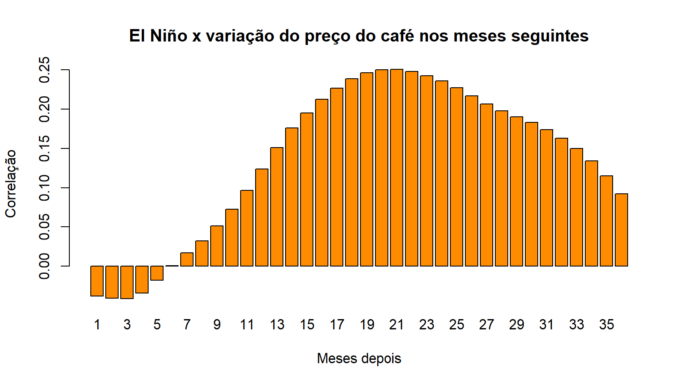
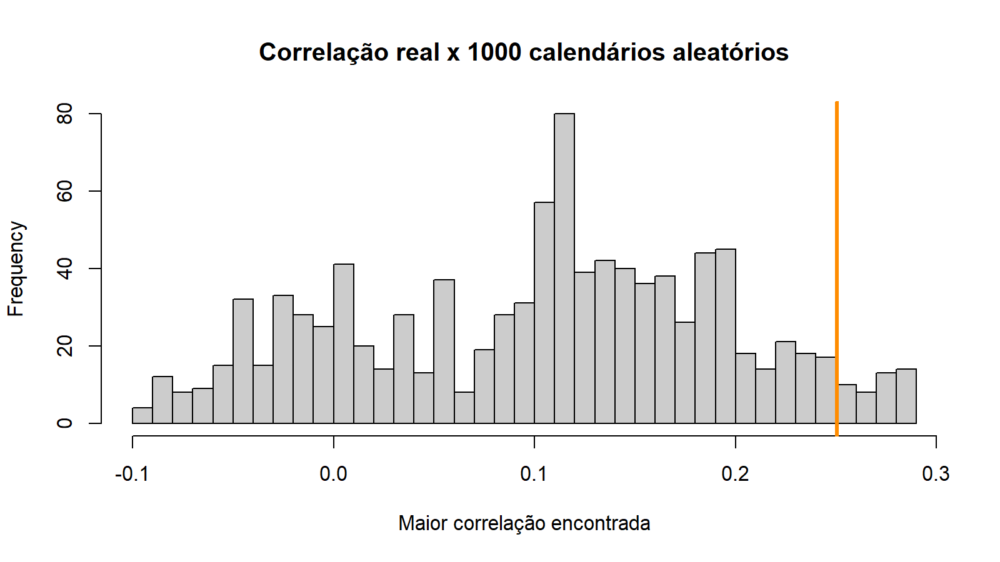
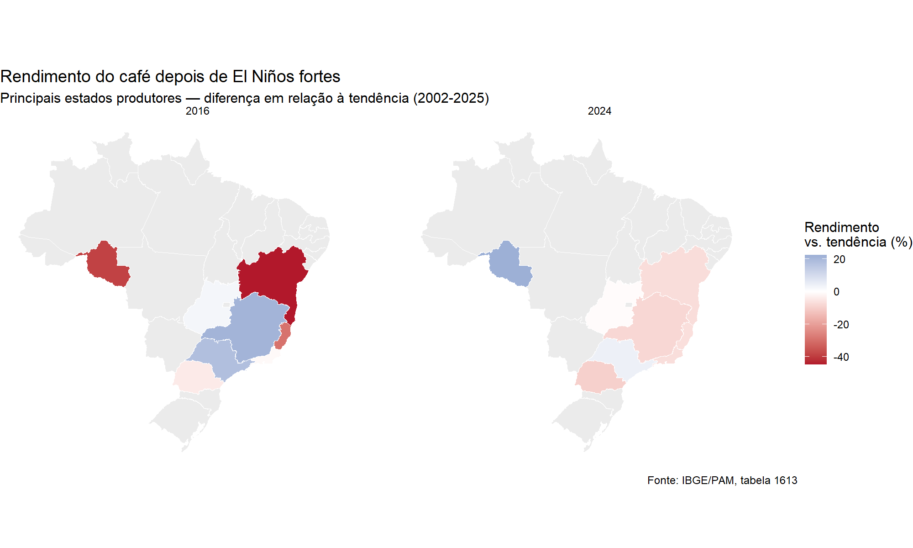

# ☕ El Niño e o café brasileiro

**O El Niño afeta o preço do café? Onde e com quanto atraso?**

Projeto de análise de dados em R que cruza o índice climático ONI (NOAA), o preço do café arábica (CEPEA/ESALQ) e o rendimento das lavouras por estado (IBGE) para medir como o El Niño chega até o preço do café.

> **Por que agora?** Em setembro de 2026 o índice ONI chegou a **+2,46 °C**, um dos El Niños mais fortes já registrados, no mesmo nível do de 2015-16.

---

## A história em 3 gráficos

### 1. O preço não reage na hora, e sim quase 2 anos depois



Correlação entre o índice ONI e a variação do preço do café nos meses seguintes:

- **De 0 a 6 meses:** praticamente nenhuma relação.
- **A partir de 7 meses:** a correlação sobe e chega ao **pico (~0,25) por volta de 20 a 21 meses**.
- **Depois disso:** o efeito se dissipa.

Começando de um mês de El Niño, o café subiu em média **+16,6% nos 12 meses seguintes**. Começando de La Niña, ficou estável (**-0,3%**).

### 2. O padrão é real ou sorte?



Para testar, o calendário do El Niño foi "girado" 1000 vezes: o índice mantém o mesmo formato, mas fica desencaixado das datas reais. A correlação real (linha laranja) superou 95,5% dos calendários aleatórios, com **p-valor = 0,045**. O resultado é **estatisticamente significativo a 5%, mas por pouca margem**: um indício consistente, não uma prova. Desde 1996 houve poucos episódios de El Niño.

### 3. O El Niño não atinge o Brasil por igual



Rendimento (kg/ha) de cada estado comparado com a sua própria linha de tendência:

- **Safra de 2016** (depois do El Niño de 2015-16): quedas fortes nos estados de **café conilon**, com Bahia (-45%), Rondônia (-39%) e Espírito Santo (-29%). Minas Gerais e São Paulo ficaram **acima** da tendência.
- **Safra de 2024** (depois do El Niño de 2023-24): impacto bem menor, perto de zero nos grandes produtores.

---

## Conclusões

1. O efeito do El Niño no preço do café aparece com **atraso de cerca de 20 meses**, coerente com o ciclo clima → florada → safra → preço.
2. O sinal é **moderado** (correlação ~0,25, p-valor = 0,045). O El Niño é um dos fatores, ao lado de câmbio, geadas e safras de outros países.
3. O impacto é **regional**: o conilon do Norte/Nordeste/ES sofre mais que o arábica do Sudeste.
4. **Hipótese, não previsão:** se o padrão histórico se repetir, o El Niño de 2026 pode pressionar o preço por volta de 2028.

---

## Dados

| Fonte | Dado | Período |
|---|---|---|
| [NOAA – CPC](https://www.cpc.ncep.noaa.gov/data/indices/oni.ascii.txt) | Índice ONI (anomalia de temperatura do Pacífico) | 1950–2026 |
| [CEPEA/ESALQ-USP](https://www.cepea.esalq.usp.br/br/indicador/cafe.aspx) | Indicador do Café Arábica (R$ e US$/saca), diário | 1996–2026 |
| [IBGE – PAM, tabela 1613](https://sidra.ibge.gov.br/tabela/1613) | Rendimento médio do café por estado (kg/ha) | 2002–2025 |

Dados do CEPEA usados sob licença CC BY-NC 4.0. Fonte: CEPEA/ESALQ.

## Decisões metodológicas

- **Fase do ENSO:** El Niño quando ONI ≥ +0,5; La Niña quando ≤ -0,5 (critério da NOAA, simplificado mês a mês).
- **Preço em US$:** evita a distorção da inflação brasileira em 30 anos de série.
- **Variação futura, não preço no mês:** a comparação direta do preço médio por fase engana, porque o preço tem tendência de alta e o efeito tem atraso.
- **Rendimento só a partir de 2002:** até 2001 o IBGE media café "em coco", e depois passou a medir "em grão", outra unidade.
- **Anomalia vs. tendência:** cada estado é comparado com a sua própria linha de tendência, para não confundir ganho de produtividade (ex.: café clonal em Rondônia) com efeito do clima.
- **Teste de significância:** permutação por rotação circular do índice, que preserva a autocorrelação das séries e considera a escolha do melhor atraso.

## Como rodar

Requisitos: R 4.x e os pacotes `readxl`, `geobr`, `sf` e `ggplot2`.

```r
install.packages(c("readxl", "geobr", "sf", "ggplot2"))
```

Com a pasta do projeto como diretório de trabalho, rode os scripts em ordem:

| Script | O que faz |
|---|---|
| `01_indice_oni.R` | Baixa o ONI e classifica cada mês em El Niño / La Niña / Neutro |
| `02_preco_cafe.R` | Lê o preço do CEPEA, faz a média mensal e junta com o ONI |
| `03_atraso.R` | Variação futura do preço e correlação por atraso (1 a 36 meses) |
| `04_teste_significancia.R` | Teste de permutação com 1000 calendários aleatórios |
| `05_mapa_rendimento.R` | Mapa de anomalia de rendimento por estado |

## Próximos passos

- Repetir a análise para o cacau
- Separar arábica e conilon (o IBGE separa a partir de 2012)
- Incluir chuva por região (INMET) para fechar o elo clima → safra

---

**Autor:** Moises Motta · [LinkedIn](https://linkedin.com/in/moisesmotta) · [GitHub](https://github.com/MoisesMotta)
